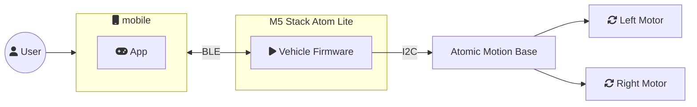

# Atomic Vehicle

*Atomic Vehicle* is a firmware to control DC motors on a vehicle using [M5 Atomic Motion Base](https://docs.m5stack.com/en/atom/Atomic_Motion_Base_v1.2).
StackChan Chariot([[EN]](https://www.hackster.io/botamochi/stackchan-chariot-47a915)/[[JP]](https://protopedia.net/prototype/7999)) is the project using this firmware.

## Build & Upload

1. Install VSCode and PlatformIO.
1. Clone this repository
1. Build and Upload to M5Stack Atom Lite

## Teleoperation

1. Install [BLE Controller – Arduino ESP32](https://play.google.com/store/apps/details?id=com.circuitmagic.iot) into a mobile device.
1. Open the App
1. Scan devices with the App and connect to *Atomic Vehicle* service
1. Move to "Remote" Tab
1. Edit Buttons in the Tab according to the following table
1. Enjoy driving!

|Label||Command Value|
|-|-|-|
|Forward (UP)|:arrow_up:|"F"|
|Backward (DOWN)|:arrow_down:|"B"|
|Left (Turn left)|:arrow_left:|"L"|
|Right (Turn right)|:arrow_right:|"R"|
