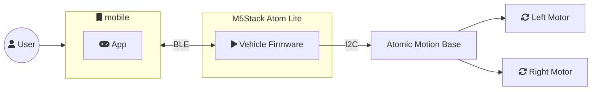

# Atomic Vehicle

*Atomic Vehicle* is a firmware to control DC motors on a vehicle using [M5 Atomic Motion Base](https://docs.m5stack.com/en/atom/Atomic_Motion_Base_v1.2).
StackChan Chariot([[EN]](https://www.hackster.io/botamochi/stackchan-chariot-47a915)/[[JP]](https://protopedia.net/prototype/7999)) is the project using this firmware.

## Build & Upload

1. Install VSCode and PlatformIO.
1. Clone this repository
1. Build and Upload to M5Stack Atom Lite

## Teleoperation

1. Install [MicroBlue](https://play.google.com/store/apps/details?id=com.snappyxo.microblue) ([iOS](https://apps.apple.com/app/id6469052831)) into a mobile device.
1. Open the App
1. Tap the Bluetooth icon at the top right and connect to *AtomicVehicle*
1. Drive with the d0 joystick or d-pad
1. Enjoy driving!

The firmware receives the text `d<k><x>,<y>` written to the following characteristic, where `k` is the widget slot and `x`, `y` are 0-1023 (512 is the center).
Only slot `d0` is used for driving: `y` is forward/backward and `x` is turning.

|Item|UUID|
|-|-|
|Service|`12345678-0000-0000-0000-123456789abc`|
|Characteristic|`12345678-0000-0000-0000-abcdef123456`|

The protocol is based on [this article](https://zenn.dev/takaki_maeda_99/articles/5c9152dfa748bb).
